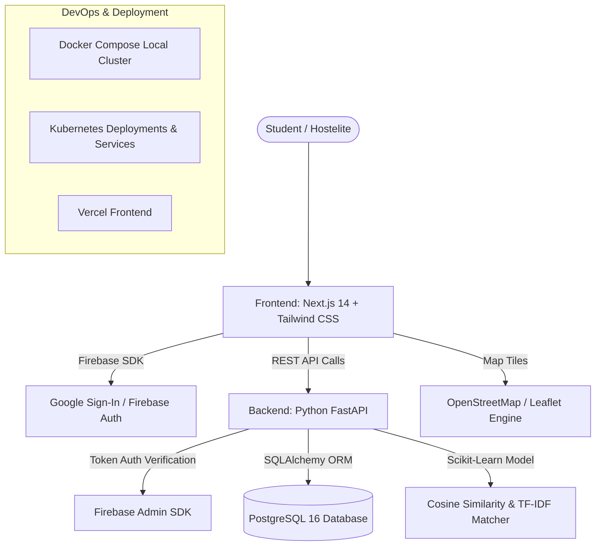

# MessMate AI – Smart Mess Recommendation Platform 🍲🤖

MessMate AI is a modern full-stack web platform built for college students, hostelites, and young professionals to discover hygienic, affordable, and dietary-compliant messes. It features interactive OpenStreetMap location discovery, weekly menu comparisons, verified student reviews, student favorites, and a scikit-learn powered AI recommendation engine.

---

## 🌟 Key Features

1. **Smart Discovery & Interactive Maps**:
   - Location-based mess discovery using **OpenStreetMap** and **Leaflet**.
   - Radius filter around campus, college gates, and hostels with real-time distance calculations using the Haversine formula.
2. **Weekly Menu & Transparent Pricing**:
   - Live daily meal schedules (Breakfast, Lunch, Snacks, Dinner) with weekend special markers.
   - Monthly subscription cost vs. walk-in per-meal pricing breakdown.
3. **AI Recommendation Engine**:
   - Multi-criteria machine learning engine built with **scikit-learn** and **NumPy**.
   - Computes preference affinity scores based on monthly budget, dietary restrictions (Pure Veg, Non-Veg, Jain), proximity, and TF-IDF cuisine keyword matching.
   - Generates human-readable explainability badges (e.g. *"Saves ₹800 on budget"*, *"Strictly Pure Veg"*, *"0.8 km from campus"*).
4. **Side-by-Side Comparison**:
   - Direct comparison matrix evaluating pricing, hygiene ratings, Sunday specials, and amenities for up to 3 messes simultaneously.
5. **Verified Student Reviews & Hygiene Ratings**:
   - Student feedback with specific kitchen cleanliness, RO water verification, and food quality scoring.
6. **Authentication & Bookmarks**:
   - Firebase Authentication with Google Sign-In and local bookmark synchronization.

---

## 🏗️ Architecture & Technology Stack



| Layer | Technologies |
| :--- | :--- |
| **Frontend** | Next.js 14, React 18, JavaScript, HTML5, CSS3, Tailwind CSS |
| **Maps & Geospatial** | Leaflet, React-Leaflet, OpenStreetMap Tiles |
| **Authentication** | Firebase Authentication (Google Sign-In Provider) |
| **Backend API** | Python 3.11+ / 3.13, FastAPI, Pydantic v2, Uvicorn |
| **Database & ORM** | PostgreSQL 16, SQLAlchemy 2.0 (with SQLite dev fallback) |
| **Machine Learning** | scikit-learn, NumPy, TF-IDF Vectorizer, Cosine Similarity |
| **DevOps & Containers**| Docker, Docker Compose, Kubernetes (Deployments, PVCs, Ingress) |

---

## 📁 Repository Structure

```text
MessMate AI/
├── backend/                        # Python FastAPI Backend
│   ├── app/
│   │   ├── api/v1/                 # Versioned REST API endpoints
│   │   │   ├── endpoints/          # messes, menus, reviews, favorites, recommendations, auth
│   │   │   └── api.py              # Main router aggregation
│   │   ├── core/                   # Pydantic settings & security config
│   │   ├── db/                     # SQLAlchemy engine, session & auto-seeder
│   │   ├── models/                 # User, Mess, Menu, Review, Favorite models
│   │   ├── schemas/                # Pydantic v2 schemas
│   │   ├── services/               # Scikit-learn AI recommendation engine
│   │   └── main.py                 # FastAPI application entry point
│   ├── .env.example                # Backend environment variable template
│   ├── Dockerfile                  # Production container definition
│   └── requirements.txt            # Python dependencies
│
├── frontend/                       # Next.js React Frontend
│   ├── src/
│   │   ├── app/                    # Next.js 14 App Router pages
│   │   │   ├── compare/            # Side-by-side comparison page
│   │   │   ├── favorites/          # Student saved messes page
│   │   │   ├── messes/             # Mess discovery list & map view
│   │   │   │   └── [id]/           # Mess menu details & review submission
│   │   │   ├── recommendations/    # AI Recommender quiz & matches
│   │   │   ├── layout.jsx          # Root layout with SEO and Navbar
│   │   │   ├── page.jsx            # Modern landing page
│   │   │   └── globals.css         # Tailwind & Leaflet styles
│   │   ├── components/             # Reusable UI (Navbar, Footer, Leaflet Map)
│   │   └── lib/                    # Firebase Auth & Axios API client
│   ├── .env.example                # Frontend environment template
│   ├── Dockerfile                  # Multi-stage production container
│   ├── next.config.js              # Next.js configuration
│   ├── package.json                # Dependencies and build scripts
│   └── tailwind.config.js          # Tailwind CSS theme
│
├── k8s/                            # Production Kubernetes Manifests
│   ├── configmap.yaml              # Environment configuration & Namespace
│   ├── postgres-deployment.yaml    # PostgreSQL Deployment, PVC, and Service
│   ├── backend-deployment.yaml     # FastAPI Deployment & Service
│   └── frontend-deployment.yaml    # Next.js Deployment, Service & Ingress
│
├── docker-compose.yml              # Local multi-container development setup
├── .gitignore                      # Git ignore rules
└── README.md                       # Complete documentation
```

---

## ⚡ First Setup & Windows Quickstart

Follow these instructions to run the application on Windows.

> **Important Windows PowerShell Tip**:
> If Windows PowerShell restricts `.ps1` scripts, use `npm.cmd` and `npx.cmd` directly instead of `npm` to avoid execution policy errors.

### 1. Prerequisites Check
Ensure you have the following installed:
- **Python**: 3.11+ or 3.13 (`python --version`)
- **Node.js**: v18+ or v20+ (`node -v`)
- **Docker & Docker Compose** (Optional for container mode: `docker --version`)

---

### 2. Backend Setup (FastAPI & Database)

Open a PowerShell terminal in the project root:

```powershell
# Navigate into backend directory
cd backend

# Create a Python virtual environment
python -m venv venv

# Activate the virtual environment
.\venv\Scripts\Activate.ps1
# (Or in Command Prompt: .\venv\Scripts\activate.bat)

# Upgrade pip and install dependencies
python -m pip install --upgrade pip
pip install -r requirements.txt

# Create environment configuration file from template
Copy-Item .env.example .env

# Run the FastAPI server (it automatically seeds initial sample messes and menus on first launch!)
uvicorn app.main:app --reload --port 8000
```

- Backend API: `http://localhost:8000`
- Interactive Swagger / OpenAPI Documentation: `http://localhost:8000/api/v1/docs`
- Health check: `http://localhost:8000/`

---

### 3. Frontend Setup (Next.js & Tailwind CSS)

Open a second PowerShell terminal in the project root:

```powershell
# Navigate into frontend directory
cd frontend

# Create environment configuration file from template
Copy-Item .env.example .env.local

# Install frontend dependencies (using npm.cmd on Windows)
npm.cmd install

# Start the Next.js development server
npm.cmd run dev
```

- Open your browser at: `http://localhost:3000`

---

### 4. Running with Docker Compose (One-Click Setup)

If you have Docker Desktop running:

```powershell
# Start PostgreSQL, FastAPI Backend, and Next.js Frontend together
docker compose up --build
```

---

## 🔑 Environment Variables Reference

### Backend (`backend/.env`)
| Variable | Description | Default |
| :--- | :--- | :--- |
| `PROJECT_NAME` | Name of the FastAPI service | `MessMate AI API` |
| `API_V1_STR` | API route prefix | `/api/v1` |
| `DATABASE_URL` | PostgreSQL or SQLite connection string | `sqlite:///./messmate_dev.db` (auto falls back for zero-config local run) |
| `CORS_ORIGINS` | Allowed frontend origins | `http://localhost:3000,http://127.0.0.1:3000` |
| `FIREBASE_PROJECT_ID` | Firebase Project ID for token auth | Optional during local testing |

### Frontend (`frontend/.env.local`)
| Variable | Description | Default |
| :--- | :--- | :--- |
| `NEXT_PUBLIC_API_URL` | Target FastAPI backend URL | `http://localhost:8000/api/v1` |
| `NEXT_PUBLIC_FIREBASE_API_KEY` | Firebase Web Client API Key | Optional (graceful mock login in dev) |
| `NEXT_PUBLIC_FIREBASE_AUTH_DOMAIN` | Firebase Web Auth Domain | Optional in dev |
| `NEXT_PUBLIC_FIREBASE_PROJECT_ID` | Firebase Project ID | Optional in dev |

---

## 📡 REST API Specification

| Method | Endpoint | Description |
| :--- | :--- | :--- |
| `GET` | `/api/v1/messes/` | Discover messes with filters (`search`, `diet_type`, `max_price`, `min_rating`, `user_lat`, `user_lng`) |
| `GET` | `/api/v1/messes/{id}` | Get complete mess details, contact info, and rating stats |
| `POST` | `/api/v1/messes/` | Register / create a new mess listing |
| `GET` | `/api/v1/menus/mess/{mess_id}` | Fetch weekly meal schedule for all 7 days |
| `POST` | `/api/v1/menus/` | Create or update daily menu items |
| `GET` | `/api/v1/reviews/mess/{mess_id}` | Retrieve verified student reviews & hygiene ratings |
| `POST` | `/api/v1/reviews/` | Submit a student review and recalculate ratings |
| `GET` | `/api/v1/favorites/` | Fetch student's bookmarked messes |
| `POST` | `/api/v1/favorites/` | Add a mess to favorites |
| `DELETE`| `/api/v1/favorites/{mess_id}` | Remove a mess from favorites |
| `POST` | `/api/v1/recommendations/personalized` | AI recommendation inference matching budget, diet, distance, and cuisine |
| `POST` | `/api/v1/auth/sync` | Synchronize Firebase authenticated Google profile |

---

## 🧠 AI Recommendation Engine Details

The recommendation engine calculates a normalized multi-factor composite score $S \in [0, 100]$:

$$S = \Big(w_1 \cdot S_{\text{budget}} + w_2 \cdot S_{\text{diet}} + w_3 \cdot S_{\text{distance}} + w_4 \cdot S_{\text{rating}} + w_5 \cdot S_{\text{cuisine}}\Big) \times 100$$

- **Budget Match ($w_1 = 30\%$)**: Rewards messes under student budget; applies linear decay penalty for over-budget listings.
- **Dietary Strictness ($w_2 = 25\%$)**: Ensures vegetarian / Jain students are strictly matched with certified pure-veg kitchens.
- **Geographic Distance ($w_3 = 15\%$)**: Haversine distance from student coordinates; prioritizes messes within walking distance.
- **Hygiene & Quality ($w_4 = 15\%$)**: Weighted combination of community ratings and kitchen cleanliness scores.
- **Cuisine Similarity ($w_5 = 15\%$)**: Scikit-learn TF-IDF vectorizer and cosine similarity on meal specialties and menu items.

---

## 🚢 Kubernetes Deployment (`k8s/`)

Deploy to any Kubernetes cluster (Minikube, EKS, GKE, AKS):

```bash
kubectl apply -f k8s/configmap.yaml
kubectl apply -f k8s/postgres-deployment.yaml
kubectl apply -f k8s/backend-deployment.yaml
kubectl apply -f k8s/frontend-deployment.yaml
```

---

## 🛡️ License & Contributing

Built for students with ❤️. Contributions, issues, and feature suggestions are welcome!
